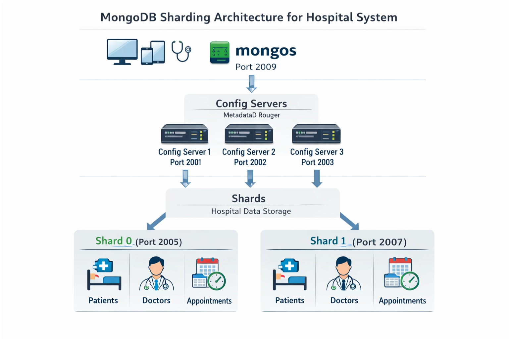

🏥 HealthCare System

A Web-Based Healthcare Support System

HealthCare is a comprehensive web application developed as a Large Data Management and Python project. The system simulates a professional hospital ecosystem where users can explore medical departments, manage doctor-patient interactions, and handle large-scale medical records efficiently.

📝 Table of Contents

•
🖼 System Architecture

•
🚀 Key Features

•
🛠 Tech Stack & Dependencies

•
⚙️ Setup and Installation

•
Prerequisites

•
Option 1: Dynamic Method (Recommended) ⚡

•
Option 2: Static Method (Manual) 🛠️

•
🔗 Cluster Initialization & Indexing

•
🚀 Running the Application

🖼 System Architecture

The following diagram illustrates the MongoDB Sharding and Replica Set architecture implemented in this project to ensure high availability and horizontal scaling.
(Note: The architecture diagram is not included in this README. Please refer to the project documentation for the visual representation.)

🚀 Key Features

•
Intuitive Landing Page: A streamlined entry point for healthcare services.

•
Department-Based Navigation: Specialized modules for Cardiology, Neurology, Dentistry, and Orthopedics.

•
Doctor Directory: Detailed profiles and scheduling for medical professionals.

•
Secure Authentication: Robust Sign-up and Login system for patients and staff.

•
Advanced Data Handling: MongoDB Sharding integration for managing massive datasets.

•
Modular Backend: Flask-based routing for scalable application logic.

🛠 Tech Stack & Dependencies

•
Frontend: HTML5, CSS3, JavaScript (ES6+).

•
Backend: Python (Flask Framework).

•
Database: MongoDB (Sharding & Replica Set cluster).

•
Libraries: Flask-PyMongo, Werkzeug.

Installation

Install the required Python packages using pip:

pip install -r requirements.txt

📈 

⚙️ Setup and Installation

This section guides you through setting up the HealthCare system, including database configuration and application dependencies.

Prerequisites

Ensure you have MongoDB installed and accessible on your system.

Option 1: Dynamic Method (Recommended) ⚡

Use the provided automation script for a quick setup:

1.
Navigate to the project root directory.

2.
Double-click RunHospitalCluster.bat.

3.
This will automatically launch all necessary instances (Config Servers, Shards, and Mongos) in separate terminals.

Option 2: Static Method (Manual) 🛠️

To manually control the cluster lifecycle, follow these steps in the command prompt:

1. Create Directory Structure

cd /d C:\Users\pc\Desktop\HealthCare-main\data\db
mkdir config1 config2 config3 shard0 shard1

2. Start Config Servers (Replica Set)

Run these commands in 3 separate terminals:

•
Port 2001: mongod --configsvr --replSet cfRS --port 2001 --dbpath ".../config1"

•
Port 2002: mongod --configsvr --replSet cfRS --port 2002 --dbpath ".../config2"

•
Port 2003: mongod --configsvr --replSet cfRS --port 2003 --dbpath ".../config3"

•
Initialize via mongosh --port 2001 using rs.initiate().

3. Start Shard Servers

Run these in 2 separate terminals:

•
Shard 0 (Port 2005): mongod --shardsvr --replSet sh0RS --port 2005 --dbpath ".../shard0"

•
Shard 1 (Port 2007): mongod --shardsvr --replSet sh1RS --port 2007 --dbpath ".../shard1"

•
Initialize each shard individually using rs.initiate().

4. Start Mongos (The Router)

mongos --configdb cfRS/localhost:2001,localhost:2002,localhost:2003 --port 2009

🔗 Cluster Initialization & Indexing

After the servers are running, connect via mongosh --port 2009 to finalize the setup:

// 1. Add Shards to the Cluster
sh.addShard("sh0RS/localhost:2005")
sh.addShard("sh1RS/localhost:2007")

// 2. Enable Sharding for the Database
sh.enableSharding("healthcare_db")
sh.shardCollection("healthcare_db.patients", { "_id": "hashed" })

// 3. Create Performance & Search Indexes
use healthcare_db
db.operations.createIndex({ "scheduling.startTime": -1 }) // Optimized Operation Sorting
db.rooms.createIndex({ "roomNumber": 1 }, { unique: true }) // Unique Room Constraint
db.news.createIndex({ title: "text", content: "text", category: "text" }) // Full-Text Search

🚀 Running the Application

Everything is now configured! You can start the Flask application and connect to the cluster at mongodb://localhost:2009.

To run the Flask application, navigate to the project root and execute:

python app.py   # Or your main Flask application file

